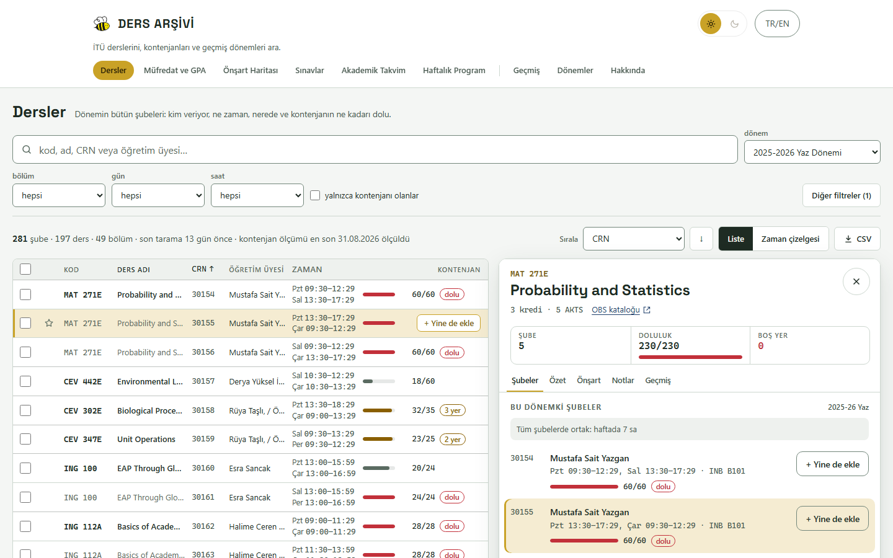
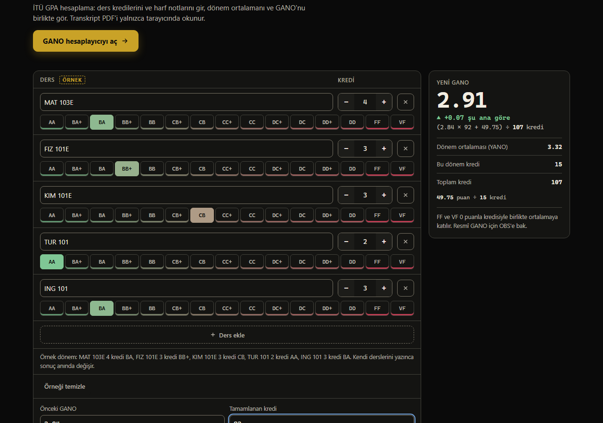

<p align="center">
  <a href="https://itu-ders.com/">
    
  </a>
</p>

<p align="center">
  <a href="https://itu-ders.com/"><b>itu-ders.com</b></a> ·
  <a href="https://itu-ders.com/ders-programi-olustur/">Ders programı</a> ·
  <a href="https://itu-ders.com/gano-hesaplama/">GANO hesaplama</a> ·
  <a href="https://itu-ders.com/kontenjan/">Kontenjan</a> ·
  <a href="https://itu-ders.com/akademik-takvim/">Akademik takvim</a>
</p>

İTÜ'nün herkese açık OBS ve akademik takvim verisini düzenli arşivleyen, bağımsız bir öğrenci aracı. Giriş yok, hesap yok; notların ve transkriptin yalnızca tarayıcında işlenir.

| | |
|---|---|
| **Dersler** | Bu dönemin ve 2016'dan beri her dönemin şubeleri, hocaları, kontenjanları ve dolma hızları |
| **Ders programı** | Haftalık program kur, çakışmaları gör, ICS/CSV olarak al |
| **GANO** | Harf notlarını tıkla, yeni GANO'yu ve şu ana göre farkını canlı gör; OBS transkriptini yapıştır |
| **Müfredat ve önşart** | Bölüm ders planı, önşart haritası, sınav ve akademik takvim |

<p align="center">
  
  
</p>

Ham veri `docs/data/` altında JSON/CSV olarak yayımlanır. Proje İTÜ'nün resmî hizmeti değildir.

## Geliştirme

```bash
go run ./cmd/scrape                       # veriyi çek
go run ./cmd/site                         # siteyi docs/ içine üret (5–10 dk)
go run ./cmd/site -assets-only            # yalnız assets-src/ değiştiyse hızlı kip
python -m http.server 8765 --directory docs
```

```bash
go test ./... && node --test docs/assets/core/core.test.js
go run ./cmd/validate -quiet && npx playwright test
```

Site Cloudflare Pages'ten `main / docs` olarak yayınlanır. Tarama, veri biçimi ve geri alma adımları için [OPERATIONS.md](OPERATIONS.md).
